# Nav Studio

**ROS 2 Nav2 주행을 브라우저에서 시뮬레이션하고, 로봇과 센서를 설계하고, 설정 여러 개를 나란히 띄워 비교하고, 벤치마크와 자동 튜닝까지 하는 2.5D 시뮬레이터.**
*A browser-based 2.5D simulator that drives the real ROS 2 Nav2 stack: design a robot and its sensors (lidar, multizone ToF, ultrasonic, depth camera), detect low obstacles and drops, run up to four configurations side by side, benchmark with statistics and auto-tune parameters.*


[](https://github.com/Hwan-Yeong/nav2_simulator_app/actions/workflows/ci.yml)
[](CHANGELOG.md)

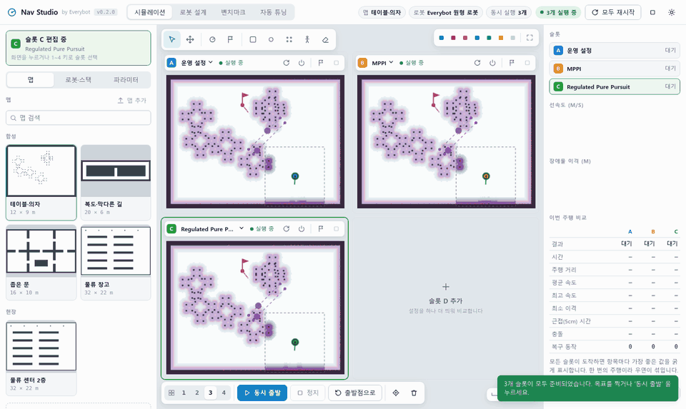

<sub>동시 실행 비교: 같은 맵·같은 보행자에서 설정 세 가지(A 운영 설정 · B MPPI · C Regulated Pure Pursuit)가 같은 순간에 출발합니다. 화면마다 실제 Nav2 스택이 따로 돌고, 다른 슬롯의 궤적이 겹쳐 보이며, 오른쪽 표가 도착 시간·속도·장애물 이격을 비교합니다. 2배속.</sub>

---

## 한눈에 보기

| | |
|---|---|
| **무엇** | 맵·로봇·센서·파라미터를 고르면 **실제 Nav2 스택**(planner · controller · BT navigator · costmap · velocity smoother)이 2.5D 시뮬레이터 위의 로봇을 실시간으로 움직이는 데스크톱급 웹 앱 |
| **왜** | 실제 로봇 없이 Nav2 설정을 바꿔 보고, 그 효과를 "느낌"이 아니라 **통계로** 판단할 환경이 없었다 |
| **규모** | Python 약 5.6k줄(서버·시뮬레이터·센서·인식·벤치마크) + JavaScript 약 3.9k줄(UI) + 테스트 약 1.1k줄 · 기본 맵 4종 · 로봇 프리셋 5종 · 센서 모델 9종 · Nav2 스택 프리셋 5종 |
| **검증** | 이 시뮬레이터 하네스로 **6,700여 회, 약 90시간 분량의 주행**을 돌려 운영 Nav2 설정을 평가함 ([케이스 스터디](#케이스-스터디-운영-nav2-설정-검증)) |
| **배포** | `pip install` + `navstudio` CLI, 또는 Docker 이미지 하나 · [사용 가이드 PDF](docs/guide/Nav_Studio_User_Guide.pdf) · 버전별 [변경 이력](CHANGELOG.md) |

## 주요 기능

| 작업 공간 | 내용 |
|---|---|
| **시뮬레이션** | 맵 선택(기본 4종 + 끌어다 놓아 추가한 맵), 출발·목표를 마우스로 지정, 실행 중에 박스·기둥·의자·보행자 배치, 장애물 높이(낮은 턱·공중)와 단차, 전역/지역 costmap·경로·라이다·센서 측정·인식 결과·궤적 실시간 표시, Nav2 경고·오류 메시지 |
| **동시 실행 비교** | 설정(또는 로봇·센서 배치)이 다른 시뮬레이션을 **최대 4개 나란히** 실행. 모두 시작 / 슬롯별 시작·정지, 모든 로봇을 같은 출발점·같은 순간에 보내는 ‘동시 출발’, 다른 슬롯 궤적 겹쳐 보기, 실시간 비교표, 그대로 벤치마크로 넘기기 |
| **파라미터 · 설정 세트** | 스택별 핵심 파라미터 슬라이더, 운영 기본값 대비 diff, YAML 오버라이드, `params.yaml` 내보내기. 스택 + 바꾼 값을 **설정 세트** 로 저장해 슬롯·벤치마크·튜닝에서 이름으로 사용 |
| **로봇 설계** | 구동 방식(차동 · 전방향 · 차량형), 원형·다각형 footprint를 상면도 CAD에서 드래그 편집, 센서 장착(위·옆에서 보며 위치·높이·pitch 끌기, 바닥에 닿는 시야 표시), 라이다 병합, 가감속·슬립, three.js 3D 미리보기. 여기서 정한 값으로 시뮬레이터와 Nav2 설정이 자동 생성됨 |
| **센서 · 인식** | 센서 라이브러리(라이다 · 1D/멀티존 ToF · 초음파 · Depth, 사양 저장·편집), 센서 종류를 파이썬 파일 하나로 추가하는 플러그인, 3D 광선 기반 측정과 실제 드라이버 형식의 토픽, 낮은 장애물·단차 인식 노드 → Nav2 costmap, **감지 범위(사각지대) 지도**: 물체별로 어느 센서가 어디서 감지하는지와 정지 거리 안에 보이는지 ([센서 문서](docs/SENSORS.md)) |
| **벤치마크** | 최대 4개 설정을 같은 시나리오(정상 · 맵에 없는 장애물 · 보행자 · 낮은·공중 장애물 · 단차)로 병렬 반복 주행. 성공률 95% 신뢰구간, 짝비교 검정, 충돌·낙하·속도·이격·복구·저크·CPU 비교, 에피소드 재생 |
| **자동 튜닝** | 고른 파라미터 범위를 Optuna(TPE)로 탐색, 실시간 순위표, 최고 설정을 바로 적용하거나 다른 맵에서 검증 |

| 로봇 · 센서 설계: 감지 범위 (사각지대 지도) | 낮은 장애물 · 단차 인식 (ToF · Depth) |
|---|---|
| 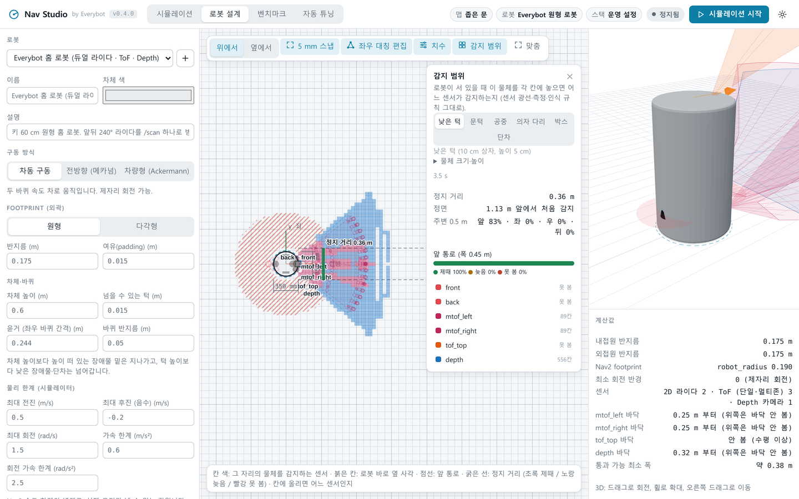 | 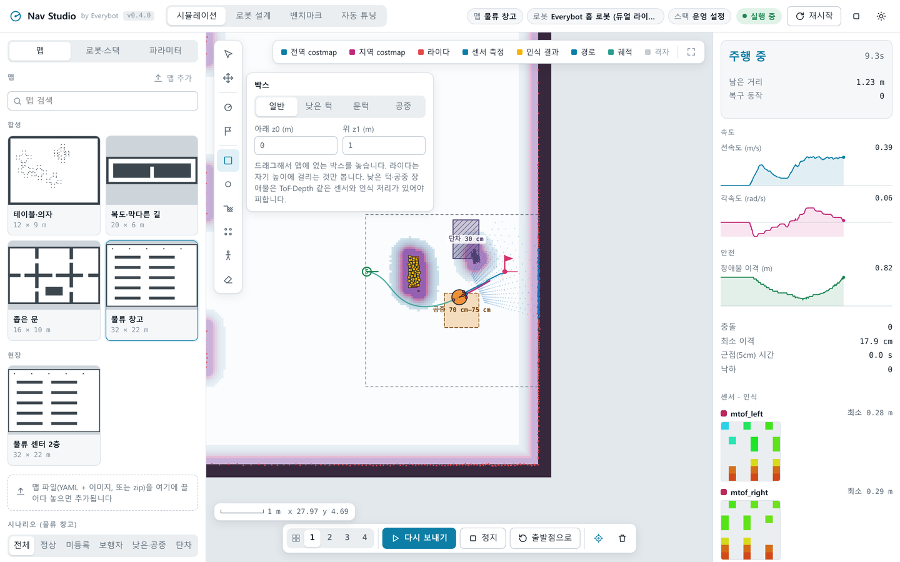 |
| **시뮬레이션 (단일)** | **동시 실행 비교** |
| 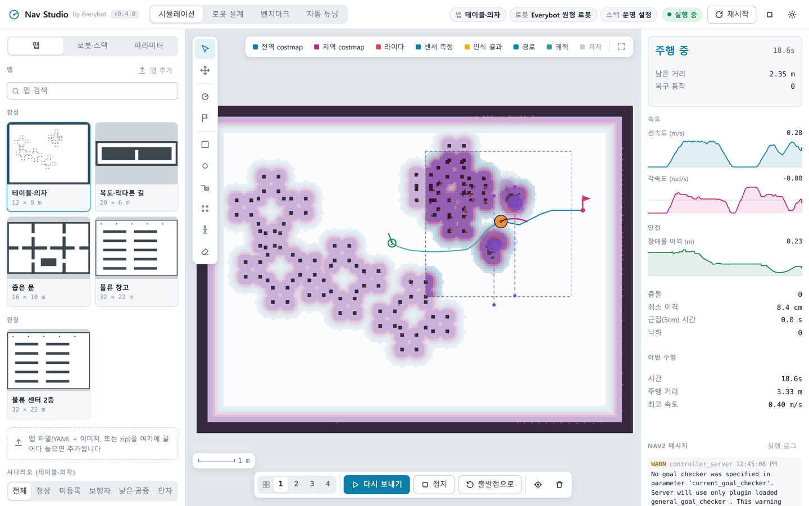 | 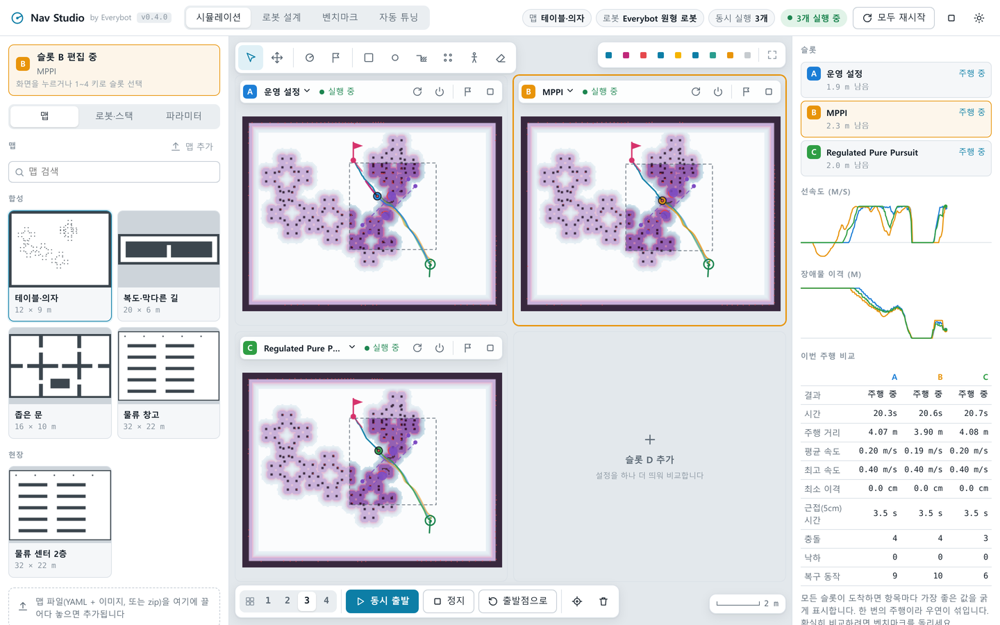 |
| **벤치마크 (통계 비교)** | **자동 튜닝 (Optuna)** |
| 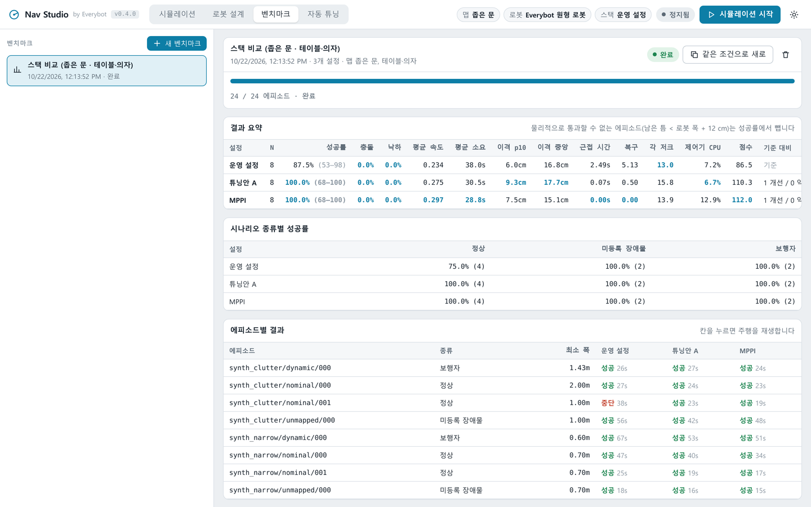 | 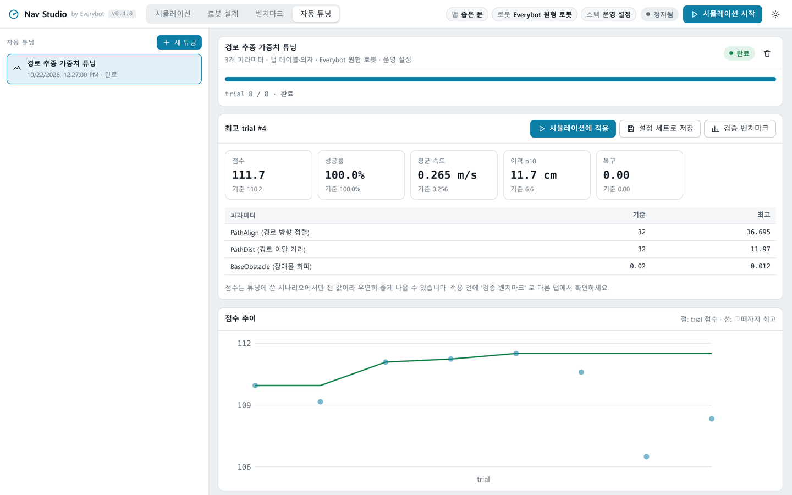 |

## 아키텍처

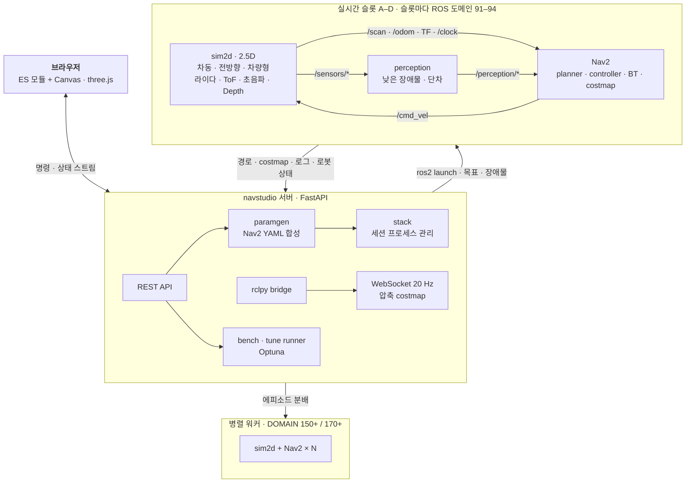

- **sim2d**: 점유 격자 + 높이 구간이 있는 장애물 + 단차로 된 2.5D 시뮬레이터. 차동·전방향·차량형 운동 모델, 원형·다각형 footprint 충돌(외곽 샘플 + 거리 변환, 등반 높이~차체 높이), 낙하, 라이다마다 자기 높이의 격자로 LaserScan·병합 `/scan`, 3D 센서는 numpy 광선 계산(`raycast`)과 센서 종류 플러그인으로 측정·발행, 로봇 앞에서 양보하는 보행자, 오도메트리 슬립. 위치는 정답 위치를 `map→odom` 으로 보정.
- **perception**: 로봇 탑재 인식 규칙(높이 띠 · 수직면 · 바닥 거리 차이 · 반사 없음 → 단차, 라이다 중복 제거, 프레임 확정, 바닥 재관측 시 지움)을 다시 구현한 노드. 확정된 점을 `/perception/obstacles`·`/perception/drops` 로 내고 costmap 의 ObstacleLayer 가 받습니다.
- **paramgen**: `운영 params.yaml → 시뮬레이터 적응 → 스택 프리셋 → 로봇 제원 → 사용자 변경` 순서로 Nav2 파라미터를 합성. footprint가 바뀌면 inflation 반경·감쇠 계수를 자동으로 맞춤.
- **bridge**: 슬롯마다 하나. 자기 rclpy Context(그 슬롯의 ROS 도메인)와 MultiThreadedExecutor 스레드에서 경로·costmap·로그·시뮬레이터 상태를 받아 WebSocket 으로 20 Hz 전송. costmap 은 zlib+base64 로 압축해 브라우저에서 `DecompressionStream` 으로 풉니다.

## 기술적으로 풀어낸 문제

**1. Nav2 는 시간을 빨리 감을 수 없다 → 실시간 1배속 + 도메인 분리 병렬화**
Nav2 Humble 의 controller · behavior 루프는 `/clock` 을 따르지 않고 wall-clock 주기(`WallRate`)로 돈다. 시뮬레이터를 배속하면 제어 주기가 상대적으로 느려져 결과가 왜곡된다. 그래서 시뮬레이션은 1배속으로 고정하고, 벤치마크·튜닝은 `ROS_DOMAIN_ID` 를 나눈 독립 인스턴스를 여러 개 동시에 돌려 처리량을 얻었다(인스턴스당 CPU 약 0.5~1코어).

**2. 개발 PC 의 ROS 환경이 결과를 오염시킨다 → 완전 격리 실행**
개발자 셸에는 다른 프로젝트의 Nav2 오버레이와 실제 로봇 IP 를 가리키는 DDS 프로파일이 걸려 있었다. 그대로 실행하면 다른 버전의 Nav2 가 로드되거나 시뮬레이션 토픽이 네트워크의 실제 로봇과 섞일 수 있다. Nav Studio 는 빈 환경(`env -i`)에서 `/opt/ros/humble` 과 자체 플러그인 오버레이만 소싱하고, `ROS_LOCALHOST_ONLY=1` 과 전용 도메인을 강제한다.

**3. 세션을 수십 번 재시작해도 고아 프로세스가 남지 않게 → 프로세스 그룹 관리**
파라미터를 바꿀 때마다 Nav2 전체를 다시 띄운다. 이전 세션의 노드가 하나라도 남으면 같은 도메인에서 TF 시간이 역행하고 목표가 거부된다. 세션을 별도 프로세스 그룹으로 띄워 PGID 를 파일로 남기고, 부모가 죽으면 함께 죽도록 `PR_SET_PDEATHSIG` 를 걸고, 서버 시작 시 남은 그룹을 정리한다.

**4. 어떤 로봇이든 Nav2 설정이 맞아야 한다 → 로봇 제원에서 파라미터 자동 유도**
사용자가 차량형 카트나 직사각형 AMR 을 그리면 footprint, 내접·외접 반경, 최소 회전 반경이 계산되고, inflation 반경(외접 반경 + 여유)과 감쇠 계수(외곽까지 비용이 남도록 상한)가 자동으로 조정된다. 차량형은 Smac Hybrid-A* + MPPI Ackermann 스택으로, 커스텀 플러그인이 없으면 표준 플래너로 대체하고 화면에 알린다. 기동 실패(잘못된 프리셋 등)는 로그에서 감지해 UI 에 바로 표시한다.

**5. "좋아 보인다" 가 아니라 "유의하다" → 통계가 들어간 벤치마크**
같은 설정을 반복 측정해 잡음 폭(성공률 ±1%p)을 먼저 정량화했다. 성공률은 Wilson 95% 신뢰구간, 설정 간 차이는 같은 에피소드 짝비교(McNemar 정확 검정)로 판정한다. 로봇이 물리적으로 지나갈 수 없는 에피소드(가장 좁은 틈 < 2 × (내접 반경 + 여유) + 12 cm)는 자동으로 분리해 성공률을 왜곡하지 않게 했다. 튜닝 점수는 튜닝에 쓴 맵에서만 잰 값이므로, UI 가 다른 맵으로 검증하는 흐름을 기본으로 안내한다.

**6. Nav2 여러 개를 한 화면에서 → 슬롯마다 도메인 · 프로세스 그룹 · rclpy Context**
설정 비교는 숫자 표보다 나란히 달리는 모습이 직관적이다. 서버 하나가 Nav2 스택 4개를 동시에 다루도록, 슬롯마다 ROS 도메인을 나누고(91~94), 프로세스 그룹을 따로 두고, rclpy Context 를 슬롯 수만큼 만들어 한 프로세스 안에서 도메인이 다른 노드들과 통신한다. 4개를 한꺼번에 띄우면 DDS 서비스 응답이 유실돼 bt_navigator 가 반쯤 활성화된 채 목표를 거부하는 경쟁 상태가 재현됐다. 그래서 기동을 2초 간격으로 두고, lifecycle manager 의 `is_active` 가 참일 때만 ‘실행 중’ 으로 올리고, 멈춘 기동은 한 번 자동 재시작한다. ‘동시 출발’ 은 모든 슬롯의 로봇·보행자를 초기 상태로 되돌린 뒤 같은 순간에 목표를 보내, 슬롯마다 시작 시각이 달라도 같은 조건에서 비교된다.

**7. 라이다가 못 보는 것을 시뮬레이션 → 2.5D 월드 + 광선 계산 + 탑재 인식 규칙 재현**
가정용 로봇은 5 cm 턱, 테이블 상판, 계단 같은 단차 때문에 멀티존 ToF·Depth 를 단다. 게임 엔진 없이 이를 다루려고 월드를 2.5D(격자 벽 + 높이 구간이 있는 장애물 + 단차)로 확장하고, 센서 광선과 바닥·단차·상자·원기둥·벽의 교차를 numpy 로 직접 계산했다(센서 하나 수 ms). 센서마다 실제 드라이버와 같은 형식(존 거리 배열, Range, 16UC1 depth + CameraInfo, 점구름)으로 내고, 로봇의 탑재 인식 알고리즘을 노드로 다시 구현해 Nav2 costmap 에 올린다. 멀티존 ToF 의 존 거리를 가장 가까운 광선으로 잡으면 평평한 바닥에서도 장애물이 생기는 문제가 있어 신호 가중(1/r²) 평균으로 바꿨다. 센서 종류는 파이썬 파일 하나(파라미터 스키마 · 광선 · 측정 · 발행 · 인식 규칙)라 UI 폼까지 자동으로 생기고, 잘못 만든 파일은 그 종류만 빠진다. 같은 낮은 장애물·단차 시나리오 8개에서 센서 로봇은 8/8 성공(충돌·낙하 0), 라이다만 있는 로봇은 1/8 성공(낙하 4회)으로, 짝비교 p = 0.016 의 차이를 벤치마크로 보였다.

**8. 배포 가능한 제품으로 → 패키지 · CLI · Docker · 자동 테스트 · 릴리스 체계**
`pip install` 한 번으로 `navstudio` 명령이 생기고, `navstudio doctor` 가 ROS 2 · Nav2 · 플러그인 · Python 패키지를 점검한다. ROS 2 Humble 의 ABI 와 맞추려고 `numpy<2` 를 고정했고, 시뮬레이터·워커는 서버와 같은 인터프리터로 띄운다. ROS 가 없는 PC 를 위해 Docker 이미지(Nav2 + 플러그인 빌드 포함)를 제공한다. ROS 없이 도는 단위 테스트(설정 세트 · 맵 가져오기 · 파라미터 합성 · 통계 · REST · 광선 계산 · 센서 플러그인 · 인식 규칙)와, 실제 Nav2 를 띄워 브라우저를 조작하는 Playwright 흐름 테스트 4종(단일 주행, 동시 비교, 설정·맵 관리, 센서·인식)이 있고, 사용 가이드의 스크린샷과 이 README 의 데모도 같은 방식으로 실제 앱에서 생성한다. 버전은 `navstudio/__init__.py` 한 곳에서 관리하고, `scripts/check.py` 가 pre-commit 훅과 CI 에서 버전 불일치·금지 이름·YAML 중복 키·깨진 링크·오래된 가이드 PDF 를 막는다 ([릴리스 절차](docs/RELEASE.md)).

## 케이스 스터디: 운영 Nav2 설정 검증

Nav Studio 는 운영 중인 원형 AMR 의 Nav2 설정을 평가하려고 만든 분석용 시뮬레이션 하네스에서 출발했다. 그 하네스의 시뮬레이터 · 시나리오 생성 · 통계 · 튜닝 코드를 누구나 쓸 수 있는 앱으로 다듬은 것이 Nav Studio 이고, 아래 분석 방법이 벤치마크 · 튜닝 기능의 기준이 되었다.

| 항목 | 내용 |
|---|---|
| 실험 규모 | 주행 **6,726회**(약 90시간 분량), 현장 맵 9종 + 합성 맵 3종, 설정 27종 + Optuna 28회 |
| 검증 방식 | 학습 맵과 분리된 검증 맵 146건, 동일 설정 반복 측정으로 잡음 폭 확인 |
| 현행 설정 | 검증 맵 성공률 **94.5%**. 27종 설정과 튜닝 어느 것도 성공률을 유의하게 높이지 못함 → 현행 설정이 이미 최적 구간에 있음 |
| 튜닝 결과 | 같은 성공률에서 평균 속도 **+14%**, 장애물 이격 중앙값 12.5 → 17.9 cm. 대신 각 저크 +25% 로 승차감 손해 |
| 실패 원인 | 맵에 없는 장애물에 가까이 붙은 로봇이 inscribed 영역에 들어가면 planner 와 controller 가 모두 탈출하지 못하는 교착. **현장 로그에서 같은 오류 메시지를 확인**해 시뮬레이터가 현장 실패를 재현함을 입증 |
| 설정 버그 | behavior_server 와 local costmap 의 기준 좌표계가 달라 후진·회전 복구 동작이 항상 실패하는 문제 발견 |
| 결론 | 성공률 개선 근거가 없어 **현행 설정 유지**. 바꾸지 않는 결정을 데이터로 뒷받침함 |

## 빠른 시작

**Docker (ROS 2 설치 없이, Windows · macOS · Linux)**

```bash
git clone https://github.com/Hwan-Yeong/nav2_simulator_app.git
cd nav2_simulator_app
docker compose -f docker/compose.yml up -d --build   # 처음 빌드 10분 안팎 (인터넷 필요)
# 같은 PC 의 브라우저에서 http://localhost:8765
```

**Ubuntu 22.04 + ROS 2 Humble**

```bash
git clone https://github.com/Hwan-Yeong/nav2_simulator_app.git && cd nav2_simulator_app
python3 -m venv ~/.navstudio-venv
~/.navstudio-venv/bin/pip install -U pip setuptools
~/.navstudio-venv/bin/pip install ".[tune]"
~/.navstudio-venv/bin/navstudio build-plugins   # 커스텀 플래너·BT 플러그인 (처음 한 번)
~/.navstudio-venv/bin/navstudio                 # http://localhost:8765 이 열림
```

| 문서 | 내용 |
|---|---|
| [사용 가이드 PDF](docs/guide/Nav_Studio_User_Guide.pdf) | 설치, 화면 구성, 시뮬레이션 · 동시 비교 · 설정 세트 · 로봇 설계 · 벤치마크 · 튜닝 · 맵 관리, 자주 묻는 것 |
| [docs/USAGE.md](docs/USAGE.md) | 설치 옵션, 다른 PC 에서 접속, 동시 실행·설정 세트·맵 관리, 단축키, 측정 방법, 확장 |
| [CHANGELOG.md](CHANGELOG.md) | 버전별 변경 이력 |
| [docs/DEVELOPMENT.md](docs/DEVELOPMENT.md) · [docs/RELEASE.md](docs/RELEASE.md) | 개발 환경·테스트·같이 고칠 문서, 릴리스 절차 |
| [docs/DESIGN.md](docs/DESIGN.md) | 설계 결정과 이유 |

<a href="docs/guide/Nav_Studio_User_Guide.pdf">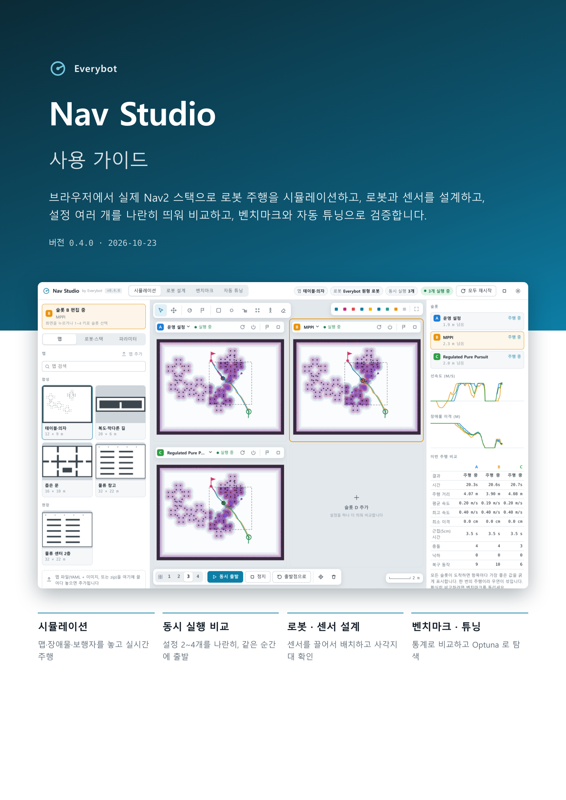</a>
<a href="docs/guide/Nav_Studio_User_Guide.pdf">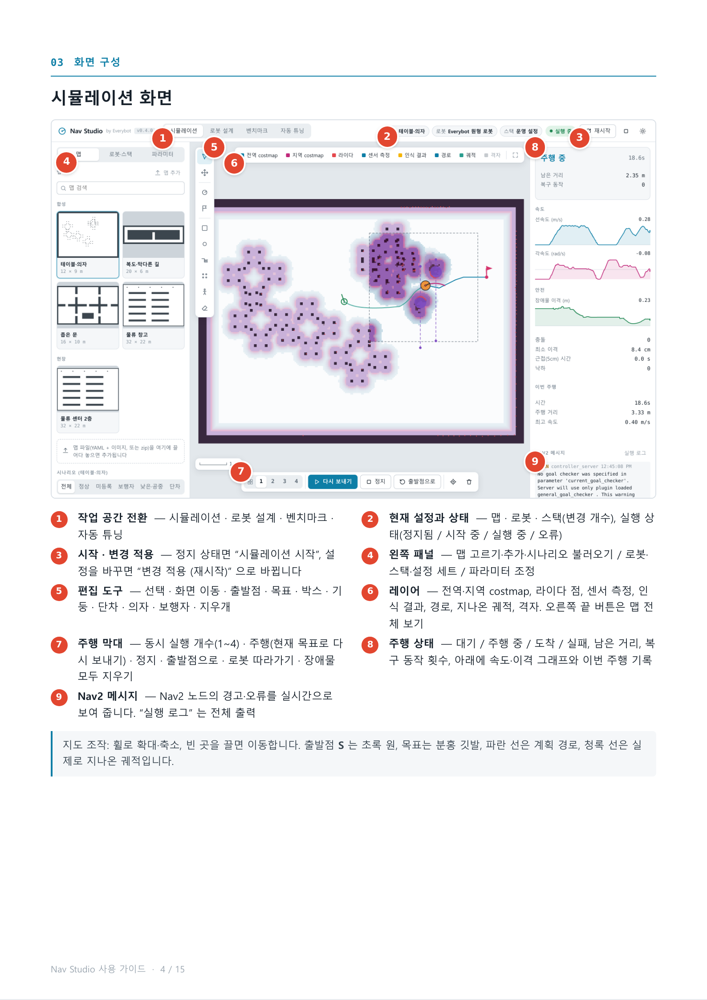</a>
<a href="docs/guide/Nav_Studio_User_Guide.pdf">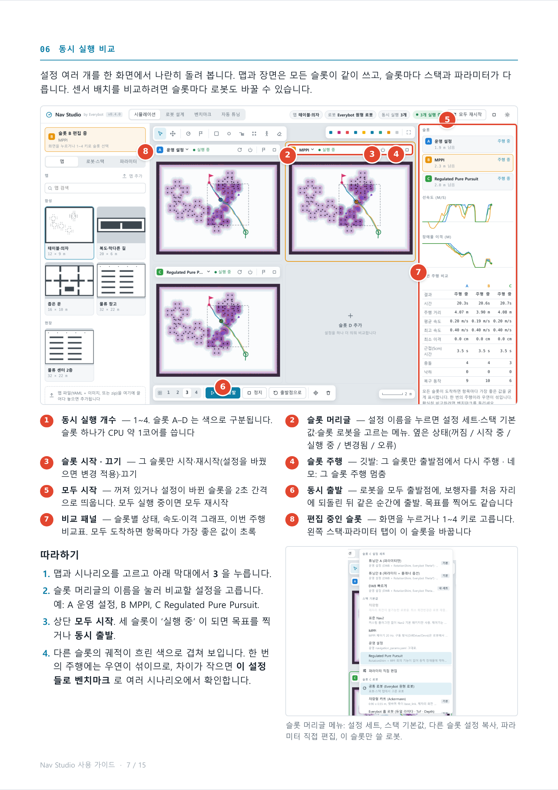</a>
<a href="docs/guide/Nav_Studio_User_Guide.pdf">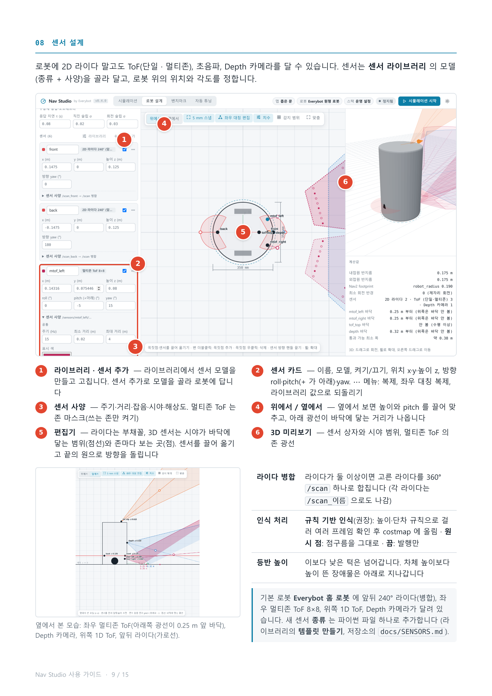</a>

## 저장소 구성

```
navstudio/
  cli.py, env.py           navstudio [run|doctor|build-plugins|maps], ROS 환경 격리
  server.py, bridge.py     FastAPI REST + WebSocket, 실시간 슬롯 4개, 슬롯별 rclpy 브리지
  configsets.py, maps.py   설정 세트 저장소, 맵 가져오기·내보내기
  stack.py                 세션 프로세스 관리 (프로세스 그룹, 고아 정리)
  paramgen.py, robot.py    Nav2 파라미터 합성, 로봇 프로파일 (센서 장착, 라이다 병합, 인식 방식)
  sensors.py, sensortypes/ 센서 모델 라이브러리, 센서 종류 플러그인 (lidar2d · tof · ultrasonic · depth)
  sim/                     sim2d(2.5D 시뮬레이터) · raycast(3D 광선) · perception(낮은 장애물·단차 인식)
  bench/                   시나리오 생성, 벤치마크 워커, 병렬 실행, 통계, Optuna 튜닝
  launch/                  시뮬레이터 + Nav2 launch 파일
  data/                    기본 맵 4종, 시나리오, 기본 Nav2 params·BT, 스택·로봇·센서·튜닝 프리셋, 센서 종류 템플릿, 플러그인 소스
  web/                     UI (ES 모듈 + Canvas, three.js)
docker/                    Dockerfile, compose.yml
docs/                      사용 가이드 PDF, 스크린샷, 데모, 사용법·개발·릴리스·설계 문서
scripts/                   check.py(검사) · release.py(버전) · 가이드·데모 캡처 · git 훅
tests/                     unit/(ROS 없이, pytest) · e2e/(Playwright 흐름)
.github/workflows/         CI: 검사 + 단위 테스트, 릴리스 태그에서 Docker 빌드
```

## 기술 스택

| 영역 | 사용 기술 |
|---|---|
| 로보틱스 | ROS 2 Humble, Nav2 1.1 (DWB · MPPI · RPP · Smac Hybrid-A* · NavFn · Theta* 기반 커스텀 플래너), rclpy, tf2 |
| 시뮬레이션 | NumPy · SciPy 기반 2.5D 시뮬레이터 (차동 · 전방향 · 차량형, 다중 라이다·병합, 3D 광선 계산 ToF · 초음파 · Depth, 보행자) |
| 백엔드 | FastAPI, uvicorn, WebSocket, psutil |
| 프런트엔드 | 빌드 도구 없는 ES 모듈, Canvas 2D, three.js |
| 실험 · 통계 | Optuna (TPE, SQLite 공유 저장소로 다중 프로세스), Wilson 신뢰구간, McNemar 검정 |
| 배포 · 테스트 | pyproject 패키지 + CLI, Docker / Compose, pytest, Playwright, GitHub Actions, Semantic Versioning + CHANGELOG |

## 한계

- 2.5D 시뮬레이션입니다. 장애물은 바닥 모양 + 높이 구간, 단차는 수직으로 꺼진 사각형입니다. 경사로·바닥 재질·RGB 영상은 다루지 않습니다.
- 위치 추정은 정답 위치를 씁니다 (오도메트리 슬립은 있지만 AMCL/SLAM 오차는 없음).
- 보행자는 정해진 경로를 왕복하며 로봇 앞에서 멈추는 단순 모델입니다.
- 결과는 설정 간 **상대 비교**로 읽어야 하며, 실제 로봇의 저수준 안전 로직은 포함하지 않습니다.

## 만든 사람

**hyjoe** · Everybot AMR 주행 SW 엔지니어 · hyjoe@everybot.net

문제 정의, 요구사항, 결과 검증은 직접 했고, 구현은 AI 코딩 에이전트(Claude Code)와 협업했습니다. 분석부터 센서 설계까지 약 사흘(2026-10-21 ~ 23)이 걸렸습니다.

Copyright © 2026 Everybot. All rights reserved. 포함된 서드파티 코드(Nav2 Theta* 기반 플래너, three.js)는 각자의 라이선스를 따릅니다 ([`NOTICE`](NOTICE)).
